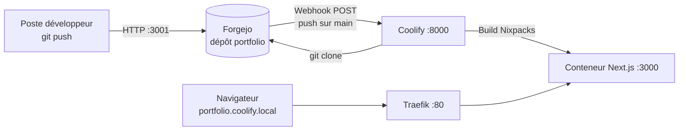
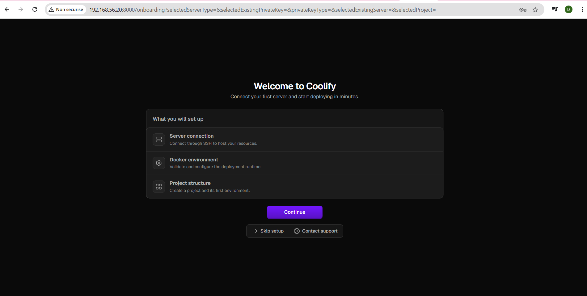
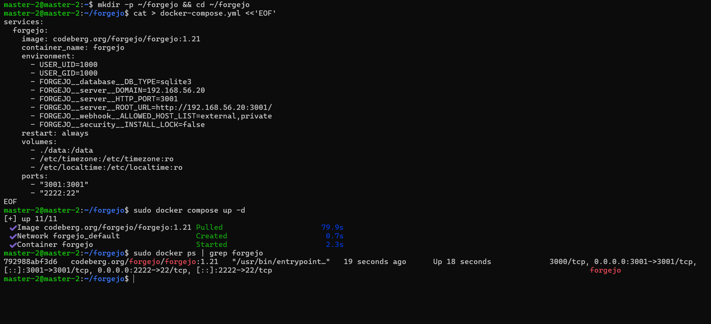
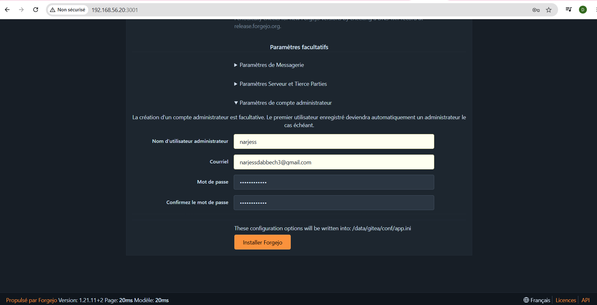
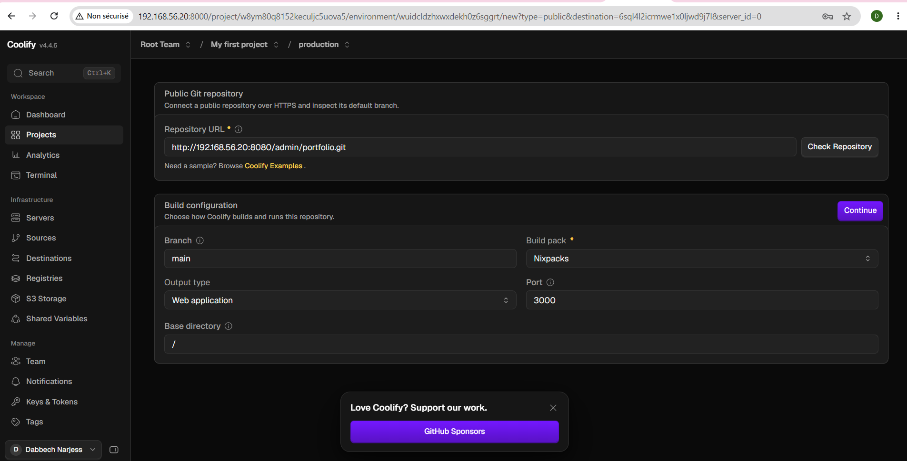
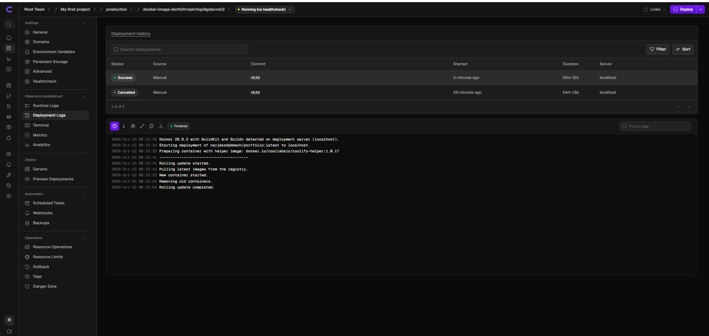
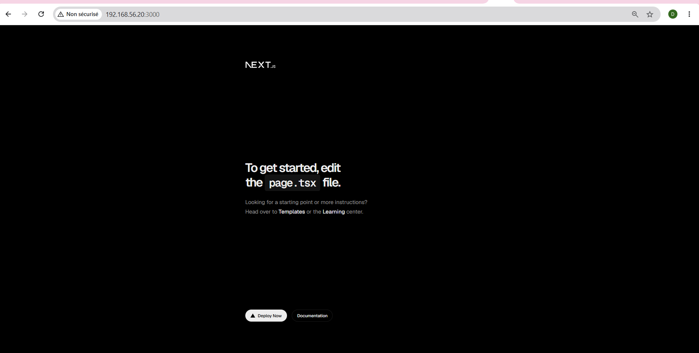
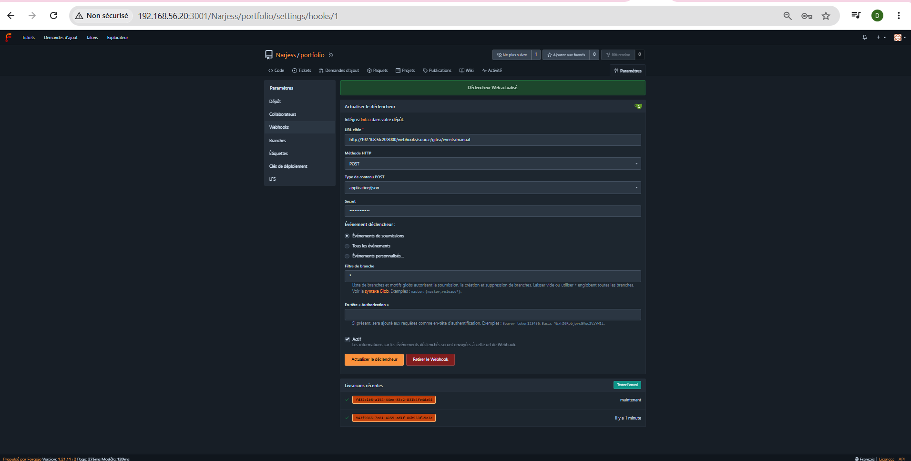
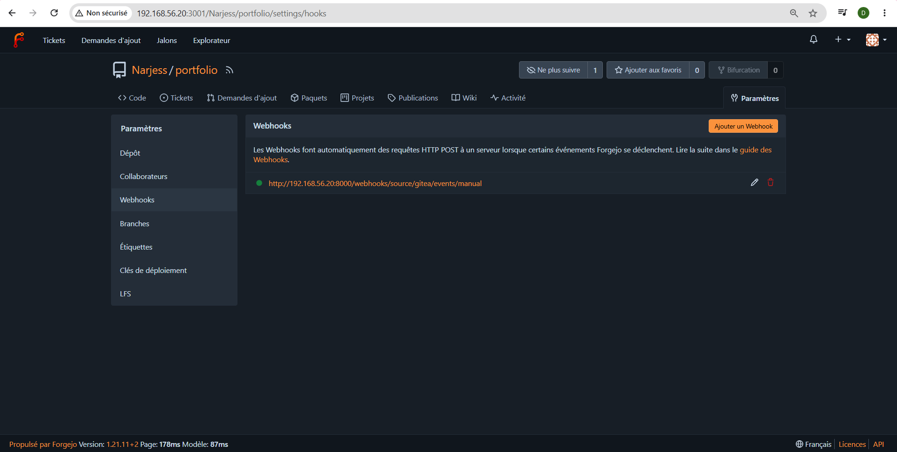
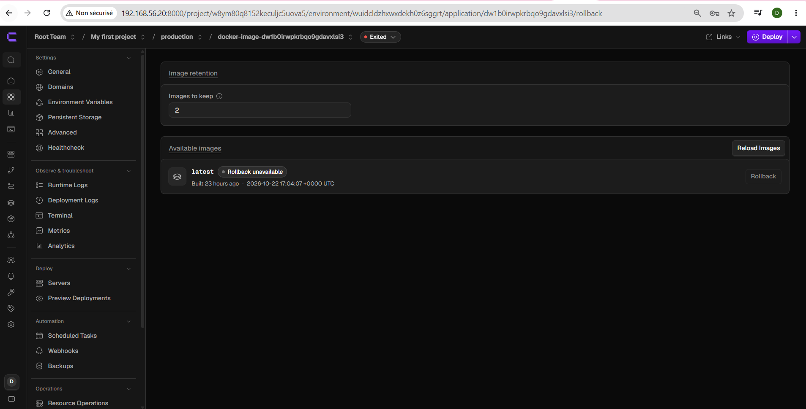

#  TP2 — Déploiement d'un Portfolio Next.js avec Coolify et Forgejo

> Déploiement continu d'un portfolio **Next.js** dans une VM locale grâce à **Coolify** (PaaS auto-hébergé) et **Forgejo** (forge Git auto-hébergée), avec redéploiement automatique à chaque `git push` via webhook.

**Auteur** : Narjess Dabbech — Master DevOps & Cloud — 2026

---

## Sommaire

1. [Objectifs](#1--objectifs)
2. [Outils et rôles](#2--outils-et-rôles)
3. [Environnement](#3--environnement)
4. [Architecture](#4--architecture)
5. [Partie A — Installation de Coolify](#5--partie-a--installation-de-coolify)
6. [Partie B — Forgejo et dépôt du portfolio](#6--partie-b--forgejo-et-dépôt-du-portfolio)
7. [Partie C — Déploiement du portfolio](#7--partie-c--déploiement-du-portfolio)
8. [Partie D — Redéploiement automatique (webhook)](#8--partie-d--redéploiement-automatique-webhook)
9. [Rollback et supervision](#9--rollback-et-supervision)
10. [Comparaison PaaS (Coolify) vs IaC (TP1)](#10--comparaison-paas-coolify-vs-iac-tp1)
11. [Difficultés rencontrées](#11--difficultés-rencontrées)
12. [Structure du dépôt](#12--structure-du-dépôt)

---

## 1.  Objectifs

- Installer **Coolify** et **Forgejo** dans une VM locale
- Déployer une application Next.js depuis un dépôt Forgejo, accessible par un nom d'hôte local
- Mettre en place un **webhook Forgejo → Coolify** : chaque `git push` redéploie l'application
- Pratiquer le **rollback** et comparer l'approche PaaS à l'approche IaC du TP1

---

## 2.  Outils et rôles

| Outil | Rôle dans le TP |
|---|---|
| **Forgejo** | Héberge le dépôt Git du portfolio ; émet le webhook à chaque push |
| **Coolify** | Clone, construit, déploie et expose l'application |
| **Traefik** (intégré à Coolify) | Routage HTTP par nom d'hôte |
| **Docker / Docker Compose** | Exécution des conteneurs (Forgejo, application) |
| **Nixpacks** | Build automatique de l'application Next.js |

---

## 3.  Environnement

| Élément | Valeur |
|---|---|
| VM | Ubuntu 24.04 — 2 vCPU — 4 Go RAM — 20 Go disque |
| IP de la VM | `192.168.56.10` |
| Nom d'hôte local | `portfolio.coolify.local` (fichier `hosts` du poste) |
| Domaine DNS / compte GitHub | Aucun (tout est local) |

**Ports utilisés dans la VM**

| Port | Service |
|---|---|
| `8000` | Dashboard Coolify |
| `80` | Traefik (proxy inverse) |
| `3001` | Forgejo (interface web) |
| `2222` | Forgejo (SSH) |
| `3000` | Application Next.js (interne) |

---

## 4.  Architecture



Chaîne de déploiement : **push → Forgejo → webhook → Coolify (clone + build) → Traefik → navigateur**.

---

## 5.  Partie A — Installation de Coolify

```bash
ip -4 a                                   # relever l'IP de la VM
ssh <utilisateur>@192.168.56.10
curl -fsSL https://cdn.coollabs.io/coolify/install.sh | bash
docker --version && docker ps             # vérifier Docker et les conteneurs Coolify
```

1. Ouvrir `http://192.168.56.10:8000`
2. Créer immédiatement le compte administrateur
3. Suivre l'assistant (serveur `localhost`)

**Vérifications** : dashboard accessible, serveur `localhost` en état *Reachable*, proxy démarré.



---

## 6.  Partie B — Forgejo et dépôt du portfolio

### B.1 Installation de Forgejo

```bash
docker compose up -d      # avec forgejo/docker-compose.yml
docker ps                 # le conteneur « forgejo » doit être Up
```

Points importants du `docker-compose.yml` :

- Port web **3001** (le 3000 est réservé à Next.js)
- `FORGEJO__webhook__ALLOWED_HOST_LIST=external,private` : indispensable, sinon Forgejo refuse d'envoyer un webhook vers une adresse privée



### B.2 Configuration initiale (`http://192.168.56.10:3001`)

| Champ | Valeur |
|---|---|
| Base de données | SQLite3 |
| Domaine du serveur | `192.168.56.10` |
| URL de base | `http://192.168.56.10:3001/` |
| Administrateur | Compte créé à l'installation |



### B.3 Dépôt du portfolio

Dépôt `portfolio` créé en **public** (clone sans authentification par Coolify), puis :

```bash
git remote add forgejo http://192.168.56.10:3001/Narjess/portfolio.git
git push -u forgejo main
```

---

## 7.  Partie C — Déploiement du portfolio

### C.1 Nom d'hôte local

Ligne ajoutée au fichier `hosts` du poste (`C:\Windows\System32\drivers\etc\hosts` sous Windows) :

```
192.168.56.10  portfolio.coolify.local
```

Test : `ping portfolio.coolify.local` répond depuis l'IP de la VM.

### C.2 Configuration dans Coolify

| Paramètre | Valeur |
|---|---|
| Projet / environnement | `portfolio` / `production` |
| Source | Public Repository |
| Repository URL | `http://192.168.56.10:3001/Narjess/portfolio.git` (IP, pas de nom d'hôte) |
| Branche | `main` |
| Build Pack | Nixpacks |
| Ports Exposes | `3000` |
| Domains | `http://portfolio.coolify.local` (préfixe `http://` obligatoire) |



### C.3 Déploiement



**Vérifications**

```bash
curl -I http://portfolio.coolify.local   # HTTP 200
docker ps                                # conteneur du portfolio visible
```

### Résultat



---

## 8.  Partie D — Redéploiement automatique (webhook)

### D.1 Côté Coolify

1. Application → onglet **Webhooks** → *Manual Git Webhooks*
2. Section **Gitea** (compatible Forgejo) : saisir un secret d'au moins 16 caractères, enregistrer, copier l'URL
3. *Advanced → Deployment → Auto deploy* : **Deploy on push (webhooks)**

### D.2 Côté Forgejo

Dépôt → *Paramètres → Webhooks → Ajouter un webhook → Forgejo*

| Champ | Valeur |
|---|---|
| URL cible | URL copiée depuis Coolify |
| Type de contenu | `application/json` |
| Secret | Identique à celui de Coolify |
| Événement | Push |
| Filtre de branche | `main` |

Clic sur **Tester la livraison** : réponse 2xx attendue.



### D.3 Vérification

```bash
git add . && git commit -m "Mise à jour du titre" && git push forgejo main
```

Un nouveau déploiement apparaît automatiquement dans l'onglet *Deployments* de Coolify, et le site affiche la modification.



---

## 9.  Rollback et supervision

**Rollback** : une erreur de build a été poussée volontairement ; le déploiement automatique a échoué, puis la version précédente a été restaurée depuis l'onglet des déploiements. Le dépôt a ensuite été corrigé.



**Supervision** : logs de l'application, `docker stats` et utilisation des ressources dans le dashboard Coolify.

---

## 10.  Comparaison PaaS (Coolify) vs IaC (TP1)

| Critère | TP1 — IaC (Vagrant / Ansible / Compose) | TP2 — PaaS (Coolify) |
|---|---|---|
| Mise en place | Plusieurs outils à écrire et maintenir | Installation en une commande |
| Configuration | Fichiers versionnés (code) | Interface web |
| Reproductibilité | Très forte (tout est dans Git) | Plus faible (état dans Coolify) |
| Déploiement continu | Pipeline à écrire (Jenkinsfile) | Webhook + auto deploy intégrés |
| Proxy / routage | À configurer (Nginx, ports) | Traefik géré automatiquement |
| Contrôle fin | Total | Limité aux options de la plateforme |
| Courbe d'apprentissage | Élevée | Faible |
| Rollback | À scripter | Intégré à l'interface |

**Conclusion** : l'IaC offre contrôle et reproductibilité ; le PaaS offre rapidité et simplicité d'exploitation.

---

## 11. 🛠️ Difficultés rencontrées

- Webhook refusé par Forgejo vers une IP privée → ajout de `ALLOWED_HOST_LIST=external,private`
- Coolify ne résout pas le fichier `hosts` du poste → URL du dépôt avec l'**IP** de la VM
- Domaine sans préfixe `http://` → Coolify tentait d'obtenir un certificat HTTPS
- *(Compléter avec vos propres difficultés)*

---

## 12.  Structure du dépôt

```
.
├── forgejo/
│   └── docker-compose.yml
├── captures/
│   ├── coolify-dashboard.png
│   ├── forgejo-docker.png
│   ├── forgejo-install.png
│   ├── coolify-config.png
│   ├── coolify-deploy.png
│   ├── portfolio.png
│   ├── forgejo-webhook.png
│   ├── coolify-autodeploy.png
│   └── coolify-rollback.png
└── README.md
```
